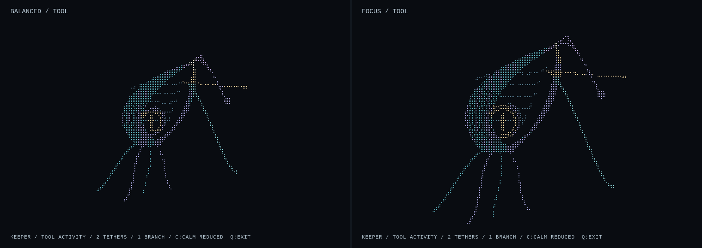

# Cyclops Keeper

A small, single-eyed presence for the Codex terminal. Keeper’s woven membrane,
crown and trailing filaments respond to observed session activity.

The current `main` branch adds an event canvas and Keeper-voiced captions that
translate observed Codex events. Install instructions below use the current
`main` source; tagged archives are separate snapshots. The
[validation results](docs/VALIDATION.md) describe the checks and measured
limits for the current source.



## Install

```bash
git clone https://github.com/CyclopsEyeTeam/cyclops-keeper.git
cd cyclops-keeper
./install.sh
```

Open a new Bash terminal, go to your project, and use:

| Command | View |
| --- | --- |
| `codex --keeper side` | Keeper beside Codex, inside the current terminal |
| `codex --keeper top` | Keeper above Codex, inside the current terminal |
| `codex --keeper` | Codex here, with Keeper in a separate fullscreen terminal |
| `codex` | Ordinary Codex |

That is the complete launch interface. Put the Keeper prefix first; any Codex
arguments or prompt follow it, for example:

```bash
codex --keeper side -C "my project"
```

In Codex, open `/hooks`, review Keeper’s hooks, then send your first message.
Keeper stays **unattached** until a trusted hook identifies that exact launch.

Installation registers the plugin and one reversible block in `.bashrc`.
The commands use Codex’s installed executable and follow its normal updates.
Running `./install.sh` again refreshes Keeper. A checkout can be moved after
installation because the commands use Codex’s installed plugin copy.

## Requirements

- Linux and Bash, with Codex plugin support.
- Python 3.10 or later; no Python packages to install.
- tmux for the two views inside your terminal.
- GNOME Terminal on an X11 desktop for the separate fullscreen view.

Existing direct `codex` aliases or functions must be removed before installing;
Keeper refuses to overwrite them. Indirect shell customisations are also refused
when a new terminal loads the integration.

The installer checks these tools and reports missing dependencies. It does not
install system packages. macOS, other shells and a Wayland fullscreen window
are outside this release’s supported setup.

Keeper adapts to the space available. If a pane becomes too small, Codex keeps
the room and Keeper returns when space settles. Returning never steals focus.
Colour and Unicode support are detected automatically; `NO_COLOR` is respected.

Side and top keep keyboard input with Codex. Press `q` in Keeper to close its
view. Codex continues running. Exiting Codex
closes only its own Keeper view. Other tmux panes and existing tmux settings
are preserved. Use your terminal’s normal copy and paste shortcuts; inside a
private tmux session, `Ctrl+B`, then `o`, switches focus between panes.

## What the expression means

Keeper translates observed events into short captions: a new turn turns the
aperture toward its line, a tool sends a thread outward and its matching return
brings that thread home, a branch opens at the side, and compaction gathers or
reopens the weave. Permission waits at a gate; interruption leaves a severed
filament. A stopped turn is not a claim of success. Missing or old evidence is
shown as unavailable.

Wide, tall views give the latest observed event its own canvas below Keeper,
with a two-row caption for the event and any still-open tool or branch threads.
Shorter views keep a compact mark or one caption line. The canvas appears only
when the matching host event is present in the current bounded event record.
Calm and reduced motion keep that event meaning while stopping decorative
movement; stale and unknown signals do not gain motion or guessed activity.

Keeper’s membrane breathes and flexes, trailing filaments sway independently,
and the crown and nearby satellite move subtly. Waiting is quieter. Arrival and
return gestures follow observed events and last long enough to read.

Active decoration targets at most 15 new bodies per second; slower idle and
calm rhythms keep their existing pace. Only changed terminal cells are written,
with a complete repaint on resize. Observed state, session identity,
attachment generation, resize, blink and motion changes invalidate the held
body immediately when observed. Drawing deadlines do not delay input or feed
polling. These are scheduling targets, not measured physical display FPS.

Once a tool or branch arrival gesture settles, its tether layer is rasterized
once and reused while Keeper’s membrane and aperture continue moving. A new
observed arrival bypasses the cache until its gesture settles. In a focused
100×32 dense PTY comparison, the layer cache reduced median renderer CPU from
35.75% to 23.94% of one core; sampled memory rose by 0.69 MiB. This is a
three-pair synthetic comparison. The complete current-source 90-case matrix
has now run: 7/15 CPU bounds, 15/15 RSS bounds and 14/15 composition bounds
passed, while 0/15 cells passed the repeatability bound. Its recommendation is
HOLD. The run uses a renderer PTY without tmux and is not a physical display
latency test; the paced 15 Hz target also produces more frames than the
uncapped control. See [validation](docs/VALIDATION.md) for full results and
limits.

Keeper does not store prompts, replies, reasoning, tool arguments, results,
transcripts, raw session IDs or project paths in its public presence feed.
Its hooks return an inert JSON object and make no permission decisions.
This release is local-only: Cyclops Link broadcasting and peer overlays are
retired. Older consent files are preserved but inactive here. Existing sessions
keep their loaded version; start a new session after refresh. See [PROTOCOL.md](PROTOCOL.md).

## Remove

```bash
./uninstall.sh
```

Open a new Bash terminal afterwards. Uninstall removes the plugin, marketplace
registration and Keeper’s startup block, preserving your other shell settings,
this checkout and recorded activity.

## Development and release

Run `./tools/check.sh` to check shell syntax and run the terminal test suite.
[Validation](docs/VALIDATION.md) records current test results, measurements,
platform limits and retained historical evidence.

MIT licensed. [Provenance](PROVENANCE.md). Independent project from the Cyclops
Eye Team; not made, endorsed or supported by OpenAI.
